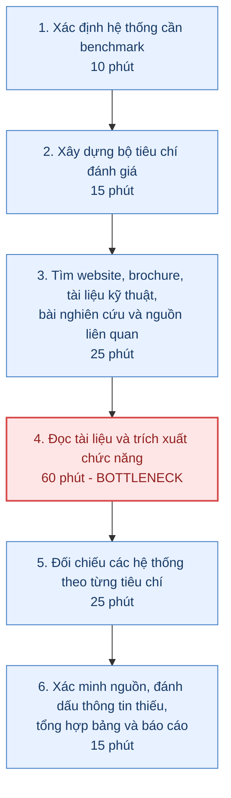
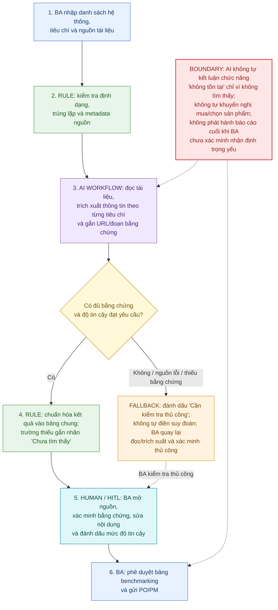

# Báo cáo nhóm — Day 02 Discovery & Problem Framing

> Bản chung của nhóm, viết trên repo do nhóm trưởng fork. Không copy file này sang repo cá nhân.
> Template chi tiết và prompt mẫu: [docs/01-worksheet.md](../../docs/01-worksheet.md). Bài mẫu: [docs/02-deliverable-example.md](../../docs/02-deliverable-example.md).

## 1. Thông tin nhóm

- Tên nhóm: NEU65
- Thành viên: Vũ Quang Thái; Nguyễn Thị Thùy Dung.
- Candidate problem được chọn (1 câu): BA trong team phát triển AI Agent y tế mất nhiều thời gian đọc, trích xuất và đối chiếu thông tin từ tài liệu của các hệ thống HIS/EHR/AI Agent để lập bảng benchmarking.
- Quyết định cuối: **Not Yet**

---

## 2. Hội tụ nhóm (CP3)

### 2.1. Pitch

| # | Người đưa ra | Candidate (Job Story ngắn) | Actor | Bottleneck | Câu hỏi phản biện nhận được (ai hỏi) |
|---:|---|---|---|---|---|
| 1 | Vũ Quang Thái | Khi tìm sự kiện học thuật, năng khiếu và Đoàn–Hội ở NEU, tôi muốn tìm thông tin từ nhiều nguồn tại một nơi để không phải kiểm tra từng kênh. | Sinh viên NEU | Chuyển giữa Fanpage/group, tìm và đọc bài đăng; ước lượng 15–30 phút/lần tìm kiếm, cần đo. | Chưa có biên bản pitch/phản biện; nhóm cần ghi người hỏi và câu hỏi thực tế sau buổi thảo luận. |
| 2 | Vũ Quang Thái | Khi tìm thấy nhiều sự kiện, tôi muốn tổng hợp điều kiện, đối tượng, quyền lợi, thời gian và yêu cầu để chọn hoạt động phù hợp. | Sinh viên NEU | Đọc nhiều phần của bài đăng/tài liệu; ước lượng 10–20 phút/sự kiện, cần đo. | Chưa có biên bản pitch/phản biện. |
| 3 | Vũ Quang Thái | Khi quan tâm nhiều sự kiện, tôi muốn theo dõi deadline và lịch tổ chức tại một nơi để không bỏ lỡ hoặc trùng lịch. | Sinh viên NEU | Ghi nhớ, tìm lại và đối chiếu lịch; ước lượng 5–10 phút/lần tra cứu lại, cần đo. | Chưa có biên bản pitch/phản biện. |
| 4 | Nguyễn Thị Thùy Dung | Khi nghiên cứu một bài toán nghiệp vụ y tế mới, tôi muốn tìm nguồn thông tin đầy đủ, đáng tin cậy để không tìm kiếm lặp lại trên nhiều nền tảng. | BA/Researcher trong lĩnh vực y tế | Đọc, chọn lọc và xác minh nguồn; ước lượng 45 phút ở bước đọc/xác minh; tổng quy trình 120 phút/chủ đề theo báo cáo cá nhân. | Chưa có biên bản pitch/phản biện. |
| 5 | Nguyễn Thị Thùy Dung | Khi phân tích các hệ thống HIS/EHR/AI Agent, tôi muốn so sánh điểm mạnh/yếu theo tiêu chí thống nhất để đánh giá sản phẩm và khoảng trống thị trường. | BA nghiên cứu thị trường; PO/PM sử dụng kết quả | Đọc và trích xuất thông tin chức năng; ước lượng 60 phút/hệ thống; tổng quy trình 150 phút/hệ thống theo báo cáo cá nhân. | Chưa có biên bản pitch/phản biện. |
| 6 | Nguyễn Thị Thùy Dung | Khi lịch họp thay đổi qua nhiều kênh, tôi muốn tập hợp thông báo vào một nơi để không bỏ sót lịch. | Thành viên team dự án | Đối chiếu thông báo thay đổi; ước lượng 15 phút/tuần; tổng thời gian 50 phút/người/tuần theo báo cáo cá nhân. | Chưa có biên bản pitch/phản biện. |

### 2.2. Cluster

| Cluster | Các candidate | Pattern chung |
|---|---|---|
| A. Tìm kiếm và tổng hợp thông tin | #1, #2, #4, #5 | Người dùng phải tìm qua nhiều nguồn, đọc, chọn lọc nội dung và tổng hợp thành thông tin có cấu trúc để ra quyết định. |
| B. Theo dõi và điều phối thông tin theo thời gian | #3, #6 | Thông tin thời gian/deadline thay đổi hoặc phân tán; người dùng phải ghi nhớ, đối chiếu và cập nhật thủ công. |
| C. Đánh giá và lựa chọn | #2, #5 (giao với Cluster A) | Người dùng cần so sánh nhiều lựa chọn theo tiêu chí thống nhất trước khi quyết định. |

### 2.3. Opportunity Solution Tree rút gọn

```text
OUTCOME:
Giảm thời gian BA cần để tạo bảng benchmarking HIS/EHR/AI Agent mà vẫn bảo đảm các nhận định quan trọng có bằng chứng truy xuất được.

├── Opportunity A:
│   BA mất thời gian tìm và xác định tài liệu phù hợp từ nhiều nguồn.
│
├── Opportunity B:
│   BA phải đọc tài liệu dài và trích xuất chức năng theo từng tiêu chí một cách thủ công.
│
└── Opportunity C:
    BA khó đối chiếu các hệ thống theo cùng một bộ tiêu chí và phân biệt thông tin đã xác minh với thông tin chưa được công bố.
```

Những ý đã gạch bỏ vì là solution đội lốt opportunity:

- “Xây AI Agent nghiên cứu thị trường": là tên giải pháp, chưa mô tả nhu cầu.
- “Tạo dashboard benchmarking tự động”: là đầu ra giải pháp.
- “Tạo website tổng hợp sự kiện NEU”: là giải pháp cho candidate #1, chưa phải opportunity.
- “Tự động thêm lịch họp vào Google Calendar”: tính năng không phải pain.
- “Dùng Elicit/Consensus/G2”: công cụ có sẵn, không phải vấn đề người dùng.

### 2.4. Chấm điểm shortlist (1–5)

| Candidate | Actor rõ | Quy trình rõ | Pain có bằng chứng | Impact đo được | Vừa sức lab | So sánh được No AI/Rule/Workflow/Agent | Nhóm hiểu domain | Tổng |
|---|---:|---:|---:|---:|---:|---:|---:|---:|
| #1. Tìm sự kiện NEU từ nhiều nguồn | 4 | 3 | 2 | 3 | 4 | 5 | 4 | **25/35** |
| #2. Tổng hợp thông tin sự kiện để lựa chọn | 4 | 4 | 2 | 3 | 4 | 5 | 4 | **26/35** |
| #3. Theo dõi deadline/lịch sự kiện | 4 | 4 | 2 | 3 | 5 | 5 | 4 | **27/35** |
| #4. Tìm kiếm và xác minh nguồn nghiên cứu y tế | 4 | 4 | 2 | 4 | 4 | 5 | 4 | **27/35** |
| #5. Benchmarking HIS/EHR/AI Agent | 5 | 5 | 3 | 5 | 4 | 5 | 5 | **32/35** |
| #6. Tổng hợp và theo dõi lịch họp team | 5 | 5 | 3 | 4 | 5 | 4 | 5 | **31/35** |

**Candidate được chọn:** #5  
BA mất nhiều thời gian đọc, trích xuất và đối chiếu thông tin từ các hệ thống HIS/EHR/AI Agent để lập bảng benchmarking có căn cứ.**

**Vì sao chọn:**

- Actor và người sử dụng đầu ra được xác định: BA thực hiện nghiên cứu; PO/PM dùng kết quả để định hướng sản phẩm.
- Quy trình có đầu vào, các bước và đầu ra tương đối cụ thể: xác định hệ thống → tiêu chí → tìm tài liệu → trích xuất → so sánh → xác minh/báo cáo.
- Bottleneck được xác định ở bước đọc và trích xuất thông tin, ước lượng 60 phút/hệ thống; tổng thời gian ước lượng 150 phút/hệ thống.
- Có metric định lượng ban đầu: giảm thời gian xuống dưới 90 phút/hệ thống và tối thiểu 90% nhận định chức năng có nguồn bằng chứng hoặc được đánh dấu chưa xác minh.
- Có thể thử nghiệm trên một nhóm nhỏ hệ thống và một bộ tiêu chí cố định.
- Có thể so sánh No AI, Rule và AI Workflow; chưa có căn cứ để cần Agent tự chủ.

**Vì sao loại các candidate còn lại:**

- #1 và #2 vềsự kiện NEU: có pain hợp lý nhưng cần xác minh quy mô nhu cầu, nguồn dữ liệu và mức độ sinh viên thực sự gặp khó. Khác domain với bài toán nghiên cứu hệ thống y tế của thành viên còn lại.
- #3 về deadline, lịch sự kiện: có thể giải quyết bằng Google Calendar/Sheets và quy tắc nhắc lịch; AI chưa tạo giá trị rõ ràng.
- #4 tìm kiếm nguồn nghiên cứu y tế: là vấn đề gần với #5 nhưng phạm vi rộng hơn, khó xác định thế nào là “đủ nguồn”. Một phần nhu cầu có thể đã được các công cụ tìm kiếm học thuật hỗ trợ.
- #6 lịch họp team: quy trình rõ và dễ thử nghiệm nhưng phương án lịch chung + quy ước cập nhật có thể xử lý phần lớn pain với chi phí thấp hơn AI.

**Xử lý bất đồng (nếu có):**

- Diễn biến bất đồng: Ban đầu, Dung ưu tiên bài toán phân tích và so sánh các hệ thống HIS/EHR/AI Agent vì đây là công việc thực tế của BA, có quy trình nghiên cứu rõ ràng và bottleneck ở bước đọc, trích xuất thông tin. Trong khi đó, Thái đề xuất bài toán tổng hợp thông tin sự kiện dành cho sinh viên NEU vì vấn đề gần gũi, dễ tiếp cận người dùng và có thể kiểm chứng trong phạm vi trường.

- Cách giải quyết: Nhóm không lựa chọn theo sở thích cá nhân mà đưa các candidate lên bảng chấm điểm theo 7 tiêu chí. Qua đối chiếu mức độ rõ ràng của actor, quy trình, khả năng đo lường impact, tính khả thi trong phạm vi lab và mức độ am hiểu domain của cả nhóm, nhóm thống nhất chọn bài toán phân tích, so sánh các hệ thống HIS/EHR/AI Agent. Dung và Thái đồng thuận gác lại các hướng đề xuất riêng để tập trung triển khai candidate chung ở các checkpoint tiếp theo.

---

## 3. Kiểm chứng + research giải pháp đã có (CP4)

### 3.1. Assumption Map

| # | Giả định | Loại (Value / Usability / Feasibility / Viability) | Quan trọng (1–5) | Đã có bằng chứng (1–5) | Kiểm chứng trước? |
|---:|---|---|---:|---:|---|
| 1 | BA thường xuyên phải nghiên cứu nhiều hệ thống HIS/EHR/AI Agent và cần bảng so sánh để phục vụ quyết định sản phẩm. | Value | 5 | 2 | **Có — ưu tiên 1** |
| 2 | Đọc và trích xuất thông tin chức năng từ tài liệu là công đoạn tốn thời gian nhất, khoảng 60 phút/hệ thống. | Value | 5 | 2 | **Có — ưu tiên 1** |
| 3 | Tài liệu công khai của các hệ thống có đủ thông tin để điền phần lớn tiêu chí benchmarking. | Feasibility | 5 | 2 | **Có — ưu tiên 2** |
| 4 | Có thể chuẩn hóa bộ tiêu chí để so sánh các hệ thống khác nhau mà không làm mất các khác biệt quan trọng. | Usability | 4 | 2 | Có |
| 5 | AI có thể trích xuất thông tin kèm trích dẫn đoạn nguồn với độ chính xác đủ để BA kiểm tra nhanh. | Feasibility | 5 | 1 | **Có — ưu tiên 2** |
| 6 | Lợi ích tiết kiệm thời gian lớn hơn chi phí thiết lập, kiểm tra và duy trì workflow. | Viability | 4 | 1 | Có |

**Giả định nhóm kiểm chứng trong buổi này:** Ưu tiên kiểm chứng #1 và #2 trước: BA có thực sự làm công việc benchmarking đủ thường xuyên không, và bước đọc, trích xuất có thực sự là bottleneck lớn nhất không.

### 3.2. Kiểm chứng

**Cách đã dùng:** Tổng hợp 2 interview snapshot về quy trình benchmark HIS/EHR và giải pháp phần mềm doanh nghiệp. Thời lượng và tần suất dưới đây là ước lượng theo hồi tưởng trong snapshot, chưa phải số liệu đo bằng log hoặc bấm giờ. Phần “câu nói đáng nhớ nhất” trong cả hai snapshot được ghi rõ là **mô phỏng**, vì vậy không trình bày như trích dẫn nguyên văn.

**Interview snapshot - P1:**

| Trường | Nội dung |
|---|---|
| Người được hỏi (vai trò, không ghi tên thật) | P1 - sinh viên CNTT, đảm nhiệm vai trò BA trong dự án học tập về quản lý hồ sơ bệnh án. |
| Câu nói đáng nhớ nhất (mô phỏng) | “Mình phải xem các hệ thống khác có chức năng gì trước khi đề xuất MVP. Phần mất thời gian nhất là đọc tài liệu rồi lọc đúng nội dung cần so sánh.” |
| Lần gần nhất gặp vấn đề này: chuyện gì đã xảy ra? | Khi xác định phạm vi MVP quản lý hồ sơ bệnh án, P1 tham khảo 3 hệ thống HIS/EHR, tìm website và brochure, đọc tài liệu chức năng rồi lập bảng so sánh để trao đổi với nhóm. |
| Hiện đang xử lý bằng cách nào (workaround)? | Tìm kiếm bằng Google và website nhà cung cấp, đọc tài liệu thủ công, lưu URL và ghi nhận tiêu chí trên Google Sheets. Những nội dung chưa rõ được trao đổi lại với nhóm. |
| Mất bao lâu, bao lần? | Ước lượng 150 phút/hệ thống: 25 phút tìm nguồn, 65 phút đọc/trích xuất, 35 phút đối chiếu và 25 phút tổng hợp. Tần suất được ước lượng khoảng 2 lần/tuần trong giai đoạn phân tích yêu cầu. |
| Insight / opportunity rút ra | Trong bối cảnh dự án học tập của P1, đọc và trích xuất thông tin là bước tốn thời gian nhất (65 phút/hệ thống). Đây là tín hiệu ban đầu cho thấy việc tìm đúng nội dung trong tài liệu có thể là bottleneck; tuy nhiên, trường hợp này chưa đại diện cho BA chuyên nghiệp. |

**Interview snapshot - P2:**

| Trường | Nội dung |
|---|---|
| Người được hỏi (vai trò, không ghi tên thật) | P2 - Software Engineer có 2 năm kinh nghiệm, từng phối hợp với BA để đánh giá giải pháp phần mềm doanh nghiệp. |
| Câu nói đáng nhớ nhất (mô phỏng) | “Đọc mô tả tính năng khá nhanh, nhưng khó biết chức năng nhà cung cấp quảng bá có thực sự đáp ứng đúng tiêu chí của mình không.” |
| Lần gần nhất gặp vấn đề này: chuyện gì đã xảy ra? | Khi tham khảo 2 nền tảng phần mềm doanh nghiệp để lựa chọn cách triển khai một module, P2 cùng BA sử dụng checklist để đánh giá chức năng và khả năng tích hợp. Một số mô tả trên website chưa đủ chi tiết nên phải đối chiếu thêm tài liệu kỹ thuật. |
| Hiện đang xử lý bằng cách nào (workaround)? | Sử dụng checklist yêu cầu, website nhà cung cấp và API documentation; đánh dấu “Chưa xác minh” đối với những chức năng chưa có đủ bằng chứng. |
| Mất bao lâu, bao lần? | Ước lượng 120 phút/hệ thống: 20 phút tìm nguồn, 30 phút đọc/trích xuất, 45 phút đối chiếu/xác minh và 25 phút tổng hợp. Tần suất được ước lượng khoảng 1–2 lần/tháng. |
| Insight / opportunity rút ra | Trong bối cảnh P2 mô tả, đối chiếu và xác minh chức năng là bước tốn thời gian nhất (45 phút/hệ thống), nhiều hơn thời gian đọc/trích xuất (30 phút). Bottleneck có thể thay đổi theo vai trò, tiêu chí đánh giá và loại tài liệu; do đó không nên mặc định đọc tài liệu luôn là bước tốn thời gian nhất. |

**Tổng hợp:**

| Nguồn | Số người / số mẫu | Tín hiệu xác nhận | Tín hiệu phản bác / giới hạn |
|---|---:|---|---|
| Interview snapshot P1 và P2 | 2 người, 2 bối cảnh benchmark | Cả hai snapshot đều mô tả quy trình tìm tài liệu, trích xuất thông tin và lập bảng đối chiếu thủ công. P1 ước lượng 150 phút/hệ thống, trong đó đọc/trích xuất mất 65 phút; P2 ước lượng 120 phút/hệ thống, trong đó đối chiếu/xác minh mất 45 phút. | Hai trường hợp có bối cảnh và tần suất khác nhau; P1 là dự án học tập, P2 là phối hợp đánh giá giải pháp doanh nghiệp. Câu nói trong snapshot được ghi là mô phỏng; thời gian và tần suất là hồi tưởng, chưa được đo độc lập. Vì vậy, chưa thể khái quát thành baseline chung cho BA chuyên nghiệp. |

**Nhóm đã sửa problem thế nào sau kiểm chứng:**

Ban đầu, nhóm xác định đọc và trích xuất tài liệu là bottleneck chính của quy trình benchmark. Hai snapshot cho thấy nhận định này chỉ đúng với bối cảnh P1: bước đọc, trích xuất chiếm 65 phút trong tổng 150 phút/hệ thống. Với P2, bước đối chiếu và xác minh mới là bottleneck, chiếm 45 phút trong tổng 120 phút/hệ thống. Vì vậy, nhóm điều chỉnh cách xác định vấn đề: không chỉ tập trung tự động đọc tài liệu, mà cần hỗ trợ toàn bộ quá trình trích xuất thông tin theo tiêu chí, gắn bằng chứng nguồn và giúp người dùng đối chiếu/xác minh nhận định. BA vẫn là người kiểm tra các nội dung chưa rõ hoặc chưa đủ bằng chứng trước khi đưa vào bảng benchmarking.

### 3.3. Research giải pháp đã có

| Công cụ / case / pattern | Link | Giải bước nào trong quy trình? | Điểm mạnh | Khoảng trống / rủi ro | Bài học cho nhóm |
|---|---|---|---|---|---|
| G2 Compare | https://www.g2.com/compare | So sánh sản phẩm phần mềm theo trang sản phẩm và review người dùng; hỗ trợ xem song song 2–4 sản phẩm. | Có cấu trúc so sánh, điểm số và review; hữu ích để khảo sát sản phẩm có dữ liệu trên G2. | Không phải mọi HIS/EHR hoặc giải pháp y tế chuyên biệt đều có dữ liệu đầy đủ; review người dùng là trải nghiệm chủ quan, không thay thế tài liệu xác minh chức năng. | Không cần tự tạo lại mọi thứ từ đầu; nên tận dụng nguồn so sánh sẵn có, nhưng phải đánh dấu nguồn và độ tin cậy của từng nhận định. |
| Elicit | https://elicit.com/ | Tìm kiếm tài liệu học thuật, sàng lọc và trích xuất thông tin từ nhiều bài nghiên cứu; hỗ trợ tạo báo cáo có trích dẫn. | Có quy trình research có cấu trúc, bảng trích xuất và trích dẫn đến nguồn; phù hợp phần nghiên cứu bằng chứng học thuật/y tế. | Tập trung vào nghiên cứu khoa học, không thay thế hoàn toàn việc đọc tài liệu vendor, brochure, tài liệu kỹ thuật hoặc kiểm tra sản phẩm thực tế. | Tách nguồn học thuật khỏi nguồn sản phẩm; mỗi tiêu chí cần quy định loại bằng chứng chấp nhận được. |
| Consensus | https://consensus.app/ | Tìm kiếm và tổng hợp nghiên cứu khoa học; có thể so sánh kết quả nghiên cứu và truy xuất trích dẫn. | Tìm kiếm dựa trên paper, tổng hợp có citation và hỗ trợ so sánh kết quả nghiên cứu. | Không được thiết kế riêng để benchmark tính năng HIS/EHR; kết quả tổng hợp vẫn cần mở paper/nguồn gốc để xác minh. | AI hỗ trợ tổng hợp nhưng không được biến kết luận nghiên cứu thành khẳng định về chức năng sản phẩm nếu không có tài liệu sản phẩm chứng minh. |

---

## 4. Quy trình trước/sau (CP5)

### 4.1. Quy trình hiện tại



| Bước | Actor | Input | Output | Thời gian / tần suất | Ghi chú |
|---:|---|---|---|---|---|
| 1 | BA | Yêu cầu nghiên cứu, phạm vi sản phẩm | Danh sách hệ thống cần benchmark | 10 phút/hệ thống (ước lượng cá nhân) | Cần thống nhất phạm vi trước. |
| 2 | BA, trao đổi PO/PM khi cần | Mục tiêu nghiên cứu, nhu cầu sản phẩm | Bộ tiêu chí đánh giá | 15 phút/hệ thống (ước lượng cá nhân) | Tiêu chí có thể cần điều chỉnh theo domain. |
| 3 | BA | Tên hệ thống, từ khóa, bộ tiêu chí | Tập hợp URL/tài liệu | 25 phút/hệ thống (ước lượng cá nhân) | Chất lượng và độ đầy đủ nguồn không đồng đều. |
| 4 | BA | Website, brochure, tài liệu kỹ thuật, bài nghiên cứu | Ghi chú chức năng và bằng chứng theo tiêu chí | 60 phút/hệ thống (ước lượng cá nhân) | **Bottleneck**; phải đọc và trích xuất thủ công. |
| 5 | BA | Ghi chú của từng hệ thống | Bảng so sánh điểm giống/khác | 25 phút/hệ thống (ước lượng cá nhân) | Nguy cơ so sánh không đồng nhất nếu tiêu chí chưa chuẩn hóa. |
| 6 | BA | Bảng so sánh và nguồn gốc | Báo cáo có kết luận, nguồn và mục chưa xác minh | 15 phút/hệ thống (ước lượng cá nhân) | Cần phân biệt “không có” và “không tìm thấy”. |

**Bottleneck chính:** Bước 4, ước lượng 60 phút/hệ thống. Tổng 150 phút/hệ thống là số liệu trong báo cáo cá nhân, chưa được đo độc lập. Nhóm cần bấm giờ một tác vụ benchmark thực tế để xác lập baseline.

### 4.2. Quy trình tương lai



- **Rule:** kiểm tra định dạng, loại bỏ bản ghi trùng, chuẩn hóa tên trường và trạng thái dữ liệu.
- **AI:** đọc tài liệu được cung cấp, trích xuất mô tả chức năng theo tiêu chí và đề xuất đoạn nguồn liên quan.
- **Con người:** chọn tiêu chí, đánh giá nguồn, xác minh kết quả, xử lý mâu thuẫn và phê duyệt báo cáo.
- **HITL:** BA xác nhận từng nhận định trọng yếu trước khi đưa vào báo cáo.
- **Fallback:** quay về đọc/trích xuất thủ công với trường không có bằng chứng hoặc tài liệu không xử lý được.

### 4.3. Before / after

| Chỉ số | Trước | Sau (kỳ vọng) | Ghi chú |
|---|---:|---:|---|
| Số bước | 6 | 6 | Vẫn giữ các bước kiểm soát chất lượng; một phần thao tác đọc/trích xuất được hỗ trợ. |
| Tổng thời gian | 150 phút/hệ thống (ước lượng cá nhân) | Dưới 90 phút/hệ thống (target cá nhân đề xuất) | Target chưa được kiểm chứng; phải đo pilot. |
| Số bước thủ công | 6 bước có BA tham gia | Khoảng 3–4 bước BA chủ động thao tác/kiểm tra | BA vẫn quyết định phạm vi, xác minh và phê duyệt. |
| Bottleneck chính | Đọc và trích xuất thông tin: 60 phút/hệ thống | Xác minh bằng chứng và xử lý tài liệu khó/thiếu cấu trúc | Bottleneck có thể dịch chuyển sau tự động hóa. |
| Rủi ro mới phát sinh | Tốn thời gian, bỏ sót thông tin khi đọc thủ công | AI trích xuất sai, gắn sai nguồn, bỏ sót chức năng hoặc diễn giải quá mức | Cần citation/quote, nhãn chưa xác minh và HITL. |

---

## 5. Problem Statement v0 (CP5)

| Trường | Nội dung |
|---|---|
| **Actor** | Business Analyst phụ trách nghiên cứu và benchmarking các hệ thống HIS/EHR/AI Agent trong team phát triển sản phẩm AI y tế; PO/PM là người sử dụng kết quả. |
| **Quy trình** | BA xác định hệ thống và tiêu chí, tìm tài liệu từ nhiều nguồn, đọc/trích xuất chức năng, đối chiếu các hệ thống, xác minh và tổng hợp thành bảng/báo cáo. |
| **Bottleneck** | Bước đọc và trích xuất thông tin chức năng từ tài liệu sản phẩm; ước lượng 60 phút/hệ thống trong báo cáo cá nhân. |
| **Impact** | Quy trình được ước lượng mất 150 phút/hệ thống; khi so sánh 4 hệ thống có thể mất khoảng 10 giờ, chưa tính họp review. Đây là ước lượng cần đo lại. |
| **Success Metric** (baseline → target, cách đo) | Baseline tạm thời: 150 phút/hệ thống; target: dưới 90 phút/hệ thống. Đồng thời tối thiểu 90% nhận định về chức năng phải có nguồn bằng chứng hoặc được gắn nhãn chưa xác minh. Đo bằng tác vụ benchmark cùng bộ tiêu chí trước/sau, ghi thời gian và kiểm tra mẫu nhận định. |
| **Boundary** (AI không được làm gì; khi nào cần con người kiểm tra — HITL) | AI chỉ hỗ trợ tìm/trích xuất/tóm tắt từ nguồn được cung cấp hoặc nguồn công khai truy xuất được. Không tự suy diễn chức năng không có trong tài liệu; không biến “không tìm thấy” thành “không tồn tại”; không tự đưa khuyến nghị lựa chọn sản phẩm. BA phải xác minh nguồn và phê duyệt báo cáo cuối. |

Phản biện nhận được (từ AI hoặc nhóm khác) và nhóm có đồng ý không:

- **Phản biện 1:** “Nghiên cứu thị trường” là phạm vi rộng, không thể đo hiệu quả nếu không cố định loại hệ thống và bộ tiêu chí. **Đồng ý.** Thu hẹp thử nghiệm vào một nhóm hệ thống HIS/EHR/AI Agent và một bộ tiêu chí dùng chung.
- **Phản biện 2:** Có thể sử dụng G2, Elicit hoặc Consensus nên không nên giả định phải xây công cụ tìm kiếm mới. **Đồng ý.** Tập trung vào khoảng trống tích hợp nguồn hỗn hợp, trích xuất theo tiêu chí chuyên biệt và truy xuất bằng chứng.
- **Phản biện 3:** Rút ngắn thời gian nhưng tạo ra nhận định sai sẽ không có giá trị. **Đồng ý.** Bổ sung điều kiện chất lượng: mỗi nhận định trọng yếu có nguồn/đoạn bằng chứng hoặc được đánh dấu chưa xác minh; BA duyệt trước khi phát hành.

---

## 6. Mức can thiệp AI (CP6)

### 6.1. Ma trận độ mơ hồ × độ phức tạp

**Bài của nhóm nằm ở ô:** Độ mơ hồ **trung bình** × độ phức tạp **trung bình**.

**Vì sao:**

- Đầu vào (tên hệ thống, tiêu chí, tài liệu) và đầu ra (bảng benchmarking) có thể xác định trước.
- Một số thao tác có quy tắc rõ như chuẩn hóa trường, kiểm tra thiếu dữ liệu và loại trùng.
- Nội dung tài liệu khác định dạng và cách diễn đạt; việc xác định đoạn nào đáp ứng tiêu chí cần xử lý ngôn ngữ và ngữ cảnh.
- Đánh giá một chức năng có thực sự được hỗ trợ hay không vẫn cần phán đoán và bằng chứng; không nên giao hoàn toàn cho hệ thống tự chủ.

### 6.2. So sánh 4 mức

| Mức | Phương án cho bài của nhóm | Đủ khi nào | Rủi ro | Chọn? |
|---|---|---|---|---|
| **No AI** (sửa quy trình) | Dùng checklist, thư viện nguồn uy tín, template benchmarking và phân công người đọc từng hệ thống. | Khi số hệ thống ít, tài liệu ngắn và tần suất nghiên cứu thấp. | Vẫn tốn công đọc/trích xuất; phụ thuộc kinh nghiệm BA. | Không chọn làm hướng thử nghiệm chính, nhưng là baseline bắt buộc để so sánh. |
| **Rule** | Chuẩn hóa tên trường, kiểm tra ô trống, trùng lặp, định dạng URL và trạng thái xác minh bằng quy tắc. | Khi dữ liệu đã có cấu trúc và điều kiện kiểm tra rõ. | Không hiểu tốt nội dung tự do trong brochure/tài liệu kỹ thuật; không tự trích xuất ngữ nghĩa. | Chọn làm lớp hỗ trợ, chưa đủ để giải bottleneck đọc tài liệu. |
| **Workflow** | BA cung cấp nguồn và tiêu chí → AI trích xuất theo schema, kèm đoạn trích/URL → Rule chuẩn hóa → BA xác minh. | Khi tác vụ lặp lại, tiêu chí ổn định và con người vẫn kiểm tra đầu ra. | Trích xuất sai, bỏ sót, gắn sai nguồn hoặc tóm tắt quá mức. | **Chọn mức can thiệp chính để pilot.** |
| **Agent** | Agent tự tìm nguồn, quyết định truy vấn tiếp theo, đọc nhiều tài liệu, cập nhật bảng và đề xuất kết luận. | Chỉ khi cần xử lý nhiều vòng tìm kiếm động và đã có cơ chế kiểm soát nguồn, quyền truy cập, log và phê duyệt. | Khó kiểm soát phạm vi tìm kiếm, nguồn kém tin cậy, chi phí và lỗi dây chuyền; vượt nhu cầu thử nghiệm ban đầu. | Không chọn ở giai đoạn này. |

**Mức chọn:** **Workflow** có HITL, kết hợp Rule để kiểm tra cấu trúc.

**Vì sao không chọn mức đơn giản hơn:** No AI và Rule có thể chuẩn hóa quy trình, dữ liệu đầu ra nhưng không xử lý tốt phần đọc hiểu và trích xuất nội dung từ tài liệu tự do — bottleneck được nêu trong báo cáo cá nhân. Workflow cho phép AI hỗ trợ đúng bước này mà vẫn giữ BA kiểm soát. Chưa chọn Agent vì nhóm chưa chứng minh cần tự động tìm kiếm và ra quyết định qua nhiều bước.

### 6.3. AI Canvas rút gọn

| Thành phần | Nội dung |
|---|---|
| **Prediction** — AI dự đoán / tạo ra gì? | Trích xuất mô tả chức năng, module, đối tượng sử dụng, tích hợp và các thông tin liên quan theo từng tiêu chí benchmarking; trả về đoạn bằng chứng và nguồn. Đây là tác vụ extraction/structured generation, không phải dự đoán kết quả lâm sàng. |
| **Judgment** — con người cân nhắc, quyết định gì? | BA quyết định nguồn có đáng tin không, nội dung có thực sự đáp ứng tiêu chí không, hai hệ thống có thể so sánh trực tiếp không và nhận định nào cần đánh dấu chưa xác minh. |
| **Action** — hành động cuối cùng là gì, ai làm? | AI tạo bản nháp bảng; Rule kiểm tra cấu trúc; BA xác minh, chỉnh sửa và phê duyệt; PO/PM dùng báo cáo đã duyệt để thảo luận định hướng sản phẩm. |
| **Outcome** — đo kết quả bằng gì? | Thời gian hoàn thành mỗi hệ thống; tỷ lệ nhận định có bằng chứng; tỷ lệ trích xuất đúng trên mẫu kiểm tra; số lỗi nghiêm trọng và số lần BA phải sửa. |
| **Input** — AI cần dữ liệu đầu vào gì mỗi lần chạy? Có sẵn không? | Danh sách hệ thống, bộ tiêu chí, URL/tài liệu công khai hoặc file do BA cung cấp, schema đầu ra. Một phần có sẵn; chất lượng và quyền truy cập tài liệu cần kiểm tra từng trường hợp. |
| **Feedback** — lấy phản hồi ở đâu để cải thiện? | BA đánh dấu đúng/sai, sửa nội dung, bổ sung đoạn nguồn và phân loại lỗi (bỏ sót, trích sai, gắn sai nguồn, suy diễn). Dùng tập lỗi này để điều chỉnh prompt/schema và bộ test. |

### 6.4. Hai câu hỏi của Google PAIR

- Người dùng muốn được hỗ trợ (augment) hay giao hẳn việc (automate)? Bằng chứng: Nhu cầu trong báo cáo cá nhân là giảm thời gian đọc, trích xuất và so sánh, nhưng BA vẫn cần xác minh nguồn và chịu trách nhiệm với báo cáo. Vì vậy, người dùng muốn được hỗ trợ (augment), không giao toàn bộ quyết định cho AI. Đây hiện là giả thuyết từ quy trình mô tả, cần xác nhận qua phỏng vấn.

- AI sai kiểu nào tệ hơn, báo nhầm hay bỏ sót? Vì sao, và thiết kế đã xử lý thế nào: Cả hai đều có hại, nhưng báo nhầm rằng hệ thống có một chức năng khi nguồn không chứng minh có thể khiến PO/PM đánh giá sai năng lực sản phẩm. Bỏ sót cũng khiến benchmarking thiếu. Thiết kế yêu cầu mọi nhận định có đoạn nguồn/URL; nếu không tìm thấy bằng chứng thì ghi “Chưa tìm thấy/Chưa xác minh”, không kết luận “Không có”; BA duyệt trước khi phát hành.

---

## 7. Problem Statement v1 + tiêu chí đánh giá (CP6)

| Trường | Nội dung |
|---|---|
| **Actor** | BA nghiên cứu sản phẩm trong team phát triển AI Agent y tế; PO/PM là người dùng báo cáo benchmarking. |
| **Quy trình** | BA chọn hệ thống và bộ tiêu chí, cung cấp nguồn công khai/tài liệu, workflow trích xuất thông tin theo schema và gắn bằng chứng, Rule chuẩn hóa, BA xác minh và phê duyệt bảng so sánh. |
| **Bottleneck** | Đọc và trích xuất chức năng từ nhiều tài liệu khác định dạng; baseline tạm thời 60 phút ở bước này và 150 phút tổng/hệ thống theo ước lượng cá nhân. |
| **Impact** | Thời gian nghiên cứu cao làm chậm việc tổng hợp bằng chứng để PO/PM đánh giá hệ thống và xác định khoảng trống sản phẩm. Tác động kinh doanh cụ thể cần được xác minh thêm. |
| **Success Metric** (baseline → target, cách đo) | Tổng thời gian: 150 → dưới 90 phút/hệ thống (baseline ước lượng, phải đo lại). Chất lượng: tối thiểu 90% nhận định chức năng có nguồn/đoạn bằng chứng hoặc được đánh dấu chưa xác minh. Đo trên cùng bộ tiêu chí và cùng tập tài liệu trước/sau. |
| **Boundary** | Không tự kết luận “không có chức năng” khi không tìm thấy; không tạo thông tin ngoài nguồn; không tự xếp hạng hoặc khuyến nghị chọn vendor; không tự phát hành báo cáo. BA kiểm tra bằng chứng, xử lý mâu thuẫn và phê duyệt. |
| **AI intervention point** | Sau khi BA xác định tiêu chí và cung cấp nguồn: AI đọc tài liệu, trích xuất thông tin theo từng tiêu chí, đề xuất đoạn bằng chứng và trạng thái; Rule kiểm tra schema/thiếu trường. |
| **Mức chọn** | **Workflow** (kết hợp Rule và Human-in-the-loop). |
| **Rủi ro & người kiểm tra** | AI có thể trích sai hoặc suy diễn; nguồn công khai có thể thiếu/cũ; BA chịu trách nhiệm kiểm tra nguồn và nội dung trước khi PO/PM sử dụng. |

**Thay đổi so với v0 và lý do:**

| Trường | v0 | v1 | Vì sao đổi |
|---|---|---|---|
| Actor | BA nghiên cứu và benchmarking hệ thống y tế | BA là người vận hành workflow; PO/PM là người nhận báo cáo | Phân biệt người trực tiếp làm và người sử dụng đầu ra. |
| Quy trình | BA tự tìm, đọc, trích xuất, so sánh và xác minh | Bổ sung AI extraction + Rule validation + BA verification | Định vị rõ điểm can thiệp, không giao toàn bộ quy trình cho AI. |
| Bottleneck | Đọc và trích xuất tài liệu | Giữ nguyên, ưu tiên xử lý bằng AI Workflow | Đây là bottleneck có ước lượng thời gian cụ thể trong báo cáo cá nhân. |
| Success Metric | Giảm 150 xuống dưới 90 phút; 90% nhận định có nguồn | Giữ mục tiêu, bổ sung cách đo trên cùng bộ tiêu chí/tập tài liệu | Tránh so sánh hai tác vụ khác nhau; tách tốc độ và chất lượng. |
| Boundary | BA xác minh, AI không tự kết luận | Bổ sung trạng thái “Chưa tìm thấy/Chưa xác minh”, không tự khuyến nghị vendor | Ngăn nhầm lẫn giữa thiếu bằng chứng và không có chức năng. |

**Tiêu chí đánh giá đầu ra của AI (3–5 tiêu chí):**

| # | Tiêu chí | Đạt khi | Không đạt khi |
|---:|---|---|---|
| 1 | Độ chính xác trích xuất | Thông tin trích xuất khớp nội dung tài liệu gốc trên mẫu BA kiểm tra. | Sai tên chức năng, mô tả sai hoặc gán nhầm hệ thống. |
| 2 | Truy xuất bằng chứng | Mỗi nhận định trọng yếu có URL và đoạn trích/trang tài liệu đủ để BA kiểm tra. | Không có nguồn, nguồn không hỗ trợ nhận định hoặc dẫn sai vị trí. |
| 3 | Xử lý thông tin thiếu | Ghi “Chưa tìm thấy/Chưa xác minh” khi tài liệu không cung cấp bằng chứng. | Tự suy diễn thành “Có” hoặc “Không có”. |
| 4 | Độ bao phủ tiêu chí | Điền hoặc gắn trạng thái cho tất cả tiêu chí trong schema; không âm thầm bỏ trường. | Bỏ sót trường hoặc trộn các tiêu chí khác nhau. |
| 5 | Hiệu quả thời gian | Tổng thời gian BA hoàn tất và xác minh dưới 90 phút/hệ thống trong pilot mà không giảm chất lượng. | Không đạt thời gian mục tiêu hoặc tiết kiệm thời gian nhưng tăng lỗi nghiêm trọng. |

---

## 8. Quyết định (CP6)

### 8.1. Bốn rủi ro

| Rủi ro | Câu hỏi | Mức độ rủi ro (Thấp = an toàn / TB / Cao = nguy hiểm) | Lý do / bằng chứng |
|---|---|---|---|
| **Value** | Người dùng có thật sự cần và sẽ dùng không? | **Trung bình** | BA đã mô tả quy trình và thời gian ước lượng, nhưng chưa có phỏng vấn/log chứng minh tần suất và mức độ đau. Cần xác nhận với BA và PO/PM. |
| **Usability** | Người dùng có dùng được, có hiểu và sửa được đầu ra của AI không? | **Trung bình** | BA có chuyên môn để kiểm tra nhưng bảng đầu ra cần thống nhất schema, nguồn và trạng thái xác minh. Cần thử với người dùng thực tế. |
| **Feasibility** | Có đủ dữ liệu, công cụ, kỹ năng để làm không? | **Trung bình** | Có thể thử trên tài liệu công khai/file do BA cung cấp; tuy nhiên tài liệu khác định dạng, có thể thiếu hoặc không truy cập được. Cần pilot trên một số hệ thống cụ thể. |
| **Viability** | Có hợp chi phí, pháp lý, quy định tổ chức không? Ai vận hành? | **Trung bình** | Pilot nhỏ có thể dùng nguồn công khai và BA kiểm tra; vận hành lâu dài cần tính chi phí mô hình, lưu trữ, bản quyền tài liệu, bảo mật và người cập nhật tiêu chí. Chưa có phân tích chi phí đầy đủ. |

### 8.2. Kết luận

**Quyết định: Not Yet**

**Lý do:** Problem có actor, quy trình, bottleneck và đầu ra tương đối rõ; có thể xây dựng một pilot nhỏ.

**Nếu Go — pilot nhỏ nhất:**

Sau khi vượt qua bước kiểm chứng, pilot nhỏ nhất là chọn 2 hệ thống và 8-12 tiêu chí; BA cung cấp cùng một tập tài liệu cho quy trình thủ công và workflow hỗ trợ AI. Đo tổng thời gian, thời gian đọc, trích xuất, tỷ lệ nhận định có bằng chứng, độ chính xác trên mẫu BA đánh giá và số lỗi nghiêm trọng.

**Ngưỡng dừng:** Sau pilot trên 2 hệ thống, nếu tổng thời gian không giảm tối thiểu 20% so với baseline đã đo hoặc dưới 90% nhận định trọng yếu có bằng chứng, trạng thái xác minh hoặc xuất hiện lỗi nghiêm trọng do AI tự suy diễn chức năng, dừng tự động hóa phần trích xuất và quay về template + checklist thủ công.

---

## 9. Hạn chế và hướng tiếp theo

- Chọn 2 hệ thống, một bộ tiêu chí cố định và tập tài liệu có thể chia sẻ hợp pháp để làm pilot.
- Xây bộ dữ liệu kiểm thử nhỏ gồm tài liệu, tiêu chí, đáp án tham chiếu và đoạn bằng chứng.
- So sánh thủ công với AI Workflow theo cả thời gian và chất lượng; chỉ quyết định Go khi có kết quả đo.

---

## 10. Tài liệu tham khảo

1. G2, “Researching and customizing software recommendations on G2”: https://documentation.g2.com/help/docs/researching-and-customizing-software-recommendations-on-g2
2. G2, “Compare Software and Services”: https://www.g2.com/compare
3. Elicit Help Center, “Getting started with Elicit: Which workflow should I use?”: https://support.elicit.com/en/articles/14757543-getting-started-with-elicit-which-workflow-should-i-use
4. Elicit, “AI for research & decision-making”: https://elicit.com/
5. Consensus Help Center, “How Consensus Works”: https://help.consensus.app/en/articles/9922673-how-consensus-works
6. Consensus Help Center, “Responsible AI & Limitations”: https://help.consensus.app/en/articles/10046838-responsible-ai-limitations
